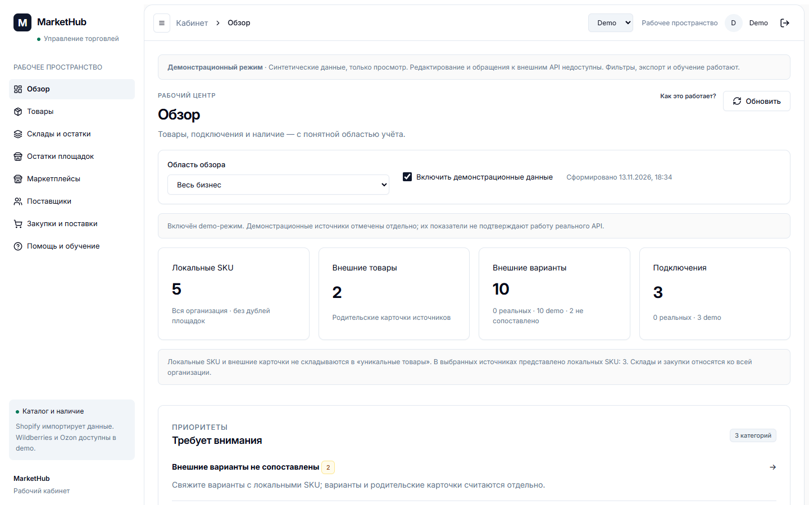
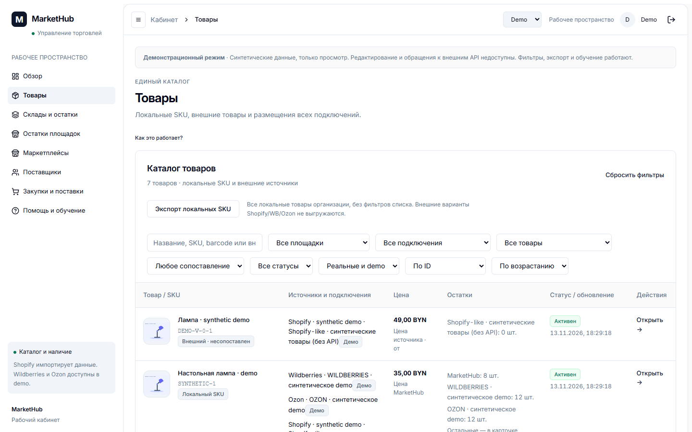
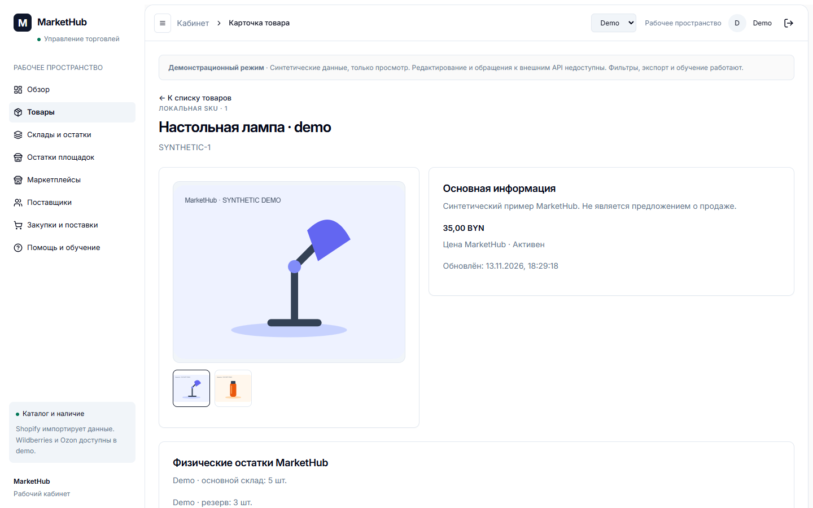
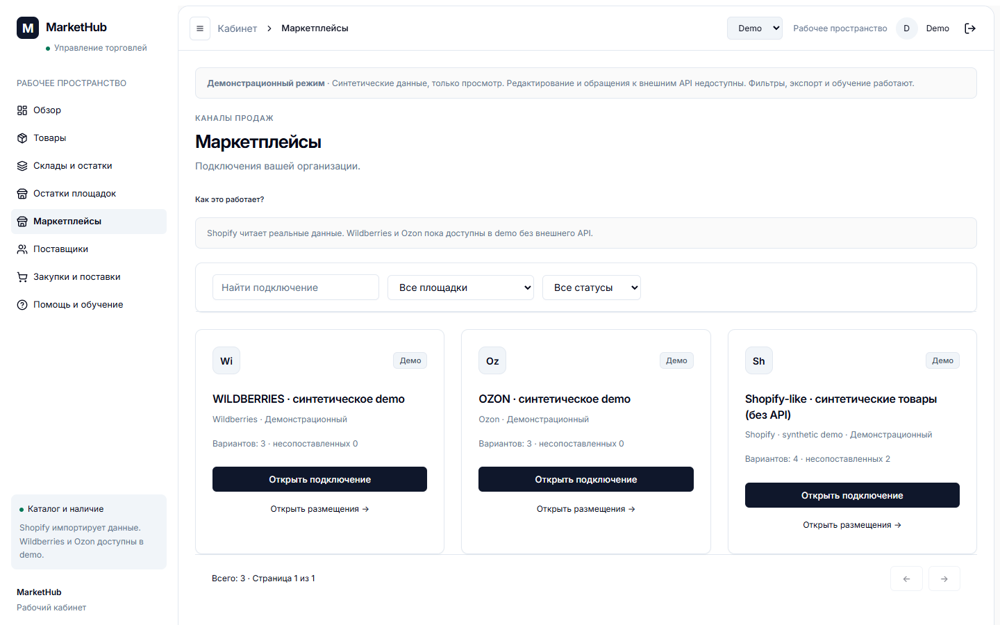
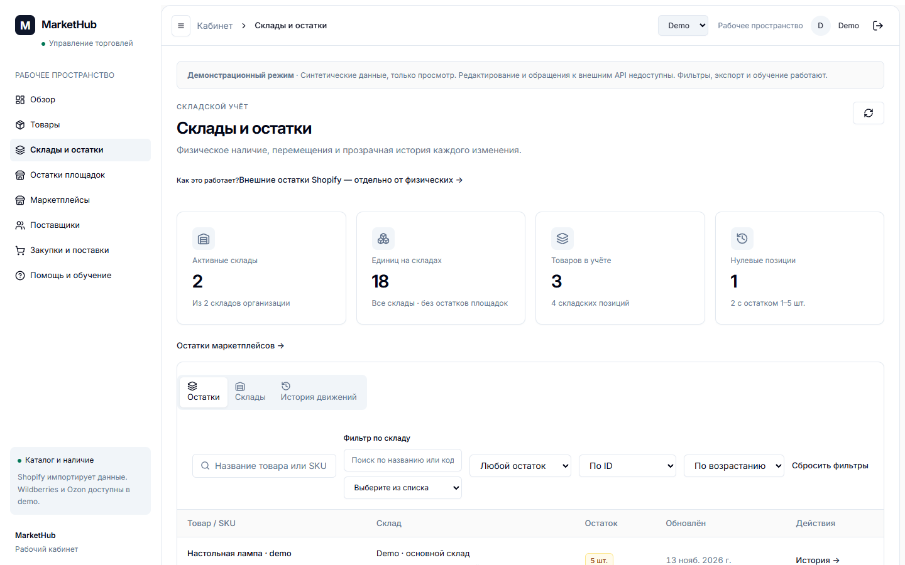
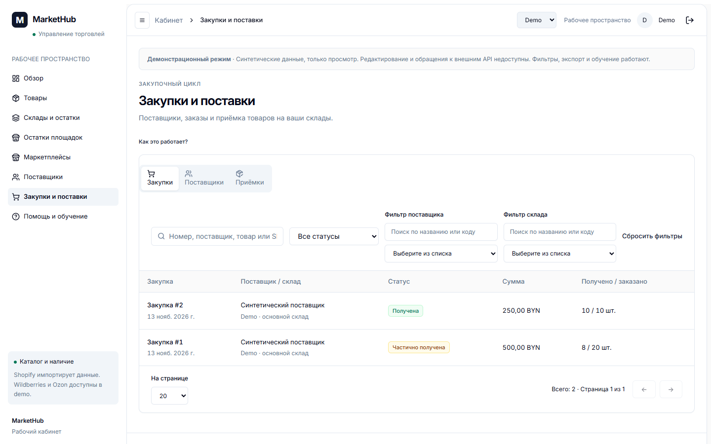
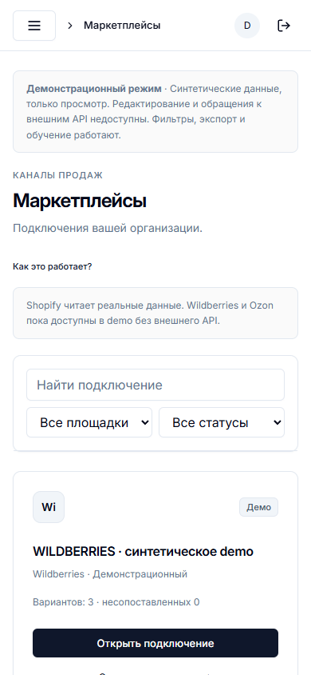

# MarketHub

**Единый каталог и складской кабинет.**

MarketHub объединяет локальные SKU и внешние карточки товаров, показывает происхождение остатков и помогает вести закупки и приёмку. Vue 3 SPA работает с Laravel REST API; PostgreSQL хранит данные, Redis обслуживает очереди и кеш. Интерфейс адаптирован для desktop, планшета и телефона.



## Возможности

- Dashboard: локальные SKU, внешние товары/варианты, состояние подключений, несопоставленные варианты, низкие остатки, закупки и последние операции. Фильтры источников явно отделяют реальные и демонстрационные данные.
- Единый каталог: поиск, фильтры, пагинация, карточки, галерея с увеличением, сопоставление внешнего варианта с локальным SKU и экспорт локальных товаров в XLSX.
- Shopify: импорт товаров, вариантов, изображений, локаций и inventory levels; очередь, история запусков и восстановление синхронизаций. Интеграция только читает данные Shopify.
- Wildberries и Ozon: демонстрационные провайдеры, без реальной API-интеграции.
- Локальные склады: физические остатки, поступление, списание, перемещение и журнал движений.
- Поставщики, закупки и частичная/полная приёмка. Подтверждённая приёмка создаёт складские движения с защитой от повторного подтверждения.
- Организации и tenant isolation, Policies, Sanctum cookie session, CSRF, валидация и ограничение частоты запросов.
- Чек-лист начала работы, центр обучения и Product Tours с управлением клавиатурой.

Покупательские заказы, продажи, платежи, финансовый учёт и расчёт выручки не реализованы.

## Данные и остатки

Локальный товар — SKU организации. Внешняя карточка и её варианты — отдельные сущности источника; несколько внешних вариантов могут ссылаться на один локальный SKU. Их количество нельзя складывать как число уникальных товаров.

**Физические остатки MarketHub и внешние снимки inventory не суммируются.** Ноль означает известное нулевое количество; отсутствие записи/снимка означает «Нет данных» или «Неизвестно». Устаревшие снимки и отключённое отслеживание показываются отдельно. Экспорт локальных SKU выгружает все локальные товары активной организации без фильтров списка; внешние варианты в него не входят.

## Демонстрационный режим

Landing содержит кнопку **«Перейти в демо версию»**. Если выделенная demo-база подготовлена, кнопка создаёт настоящую серверную сессию без ввода пароля через CSRF-защищённый POST. При отсутствии demo-конфигурации страница честно сообщает о недоступности.

Demo доступно только для явно разрешённой отдельной PostgreSQL базы с именем `_demo`, одного demo-пользователя и одной синтетической организации. Бизнес-запись запрещена middleware и Policies; прямой POST/PATCH/DELETE с валидным CSRF возвращает 403. Доступны просмотр, поиск, фильтры, экспорт, галерея и обучение; прогресс demo-экскурсий хранится в sessionStorage. Внешних запросов и реальных credentials в fixtures нет. Обычный закрытый вход остаётся на `/login`, публичных ссылок на него нет.

Публичный экземпляр ещё не развёрнут. Порядок безопасного создания demo — в [инструкции развёртывания](docs/DEPLOYMENT.md).

## Скриншоты

Все изображения сняты Playwright на синтетических данных. Полная матрица находится в [docs/assets/visual](docs/assets/visual).

| Каталог | Карточка товара |
| --- | --- |
|  |  |
| Подключения | Физические остатки |
|  |  |
| Закупки | Мобильный интерфейс |
|  |  |

[Landing](docs/assets/screenshots/landing.png) · [Мобильный каталог](docs/assets/visual/375/catalog.png)

## Архитектура

```text
Vue 3 / TypeScript / Vite
        ↓ same-origin JSON + Sanctum/CSRF
Laravel 13 → Form Requests → Policies → domain services
        ↓                         ↓
PostgreSQL                  Redis queue → providers
```

- `frontend/src`: страницы, API client, общие стили, onboarding; Vue Router и Pinia.
- `app/Http`: API `/api/v1`, Requests, Resources, middleware.
- `app/Services`: каталог, dashboard, inventory, закупки, синхронизации и demo guard.
- `database/migrations`: схема PostgreSQL и ограничения целостности.
- `tests`, `frontend/e2e`: backend, unit и браузерные проверки.
- `infra/production`: Nginx, PHP-FPM, systemd worker, cron и пример env.

Контекст организации проверяет членство; запросы и Policies ограничены активной организацией. Credentials интеграций шифруются на сервере и не передаются frontend. Физические складские операции и приёмка выполняются транзакционно. Redis worker обслуживает синхронизации; scheduler раз в минуту вызывает диспетчер готовых подключений.

## Локальный запуск

Нужны PHP 8.3+ (точную совместимость проверяет Composer), Composer 2, PostgreSQL 17, Redis-совместимый сервер, Node.js 22.12+, npm. PHP extensions: PDO/pdo_pgsql, mbstring, intl, curl, dom/XML, zip, fileinfo, openssl. Разработка возможна на Windows без Docker/WSL и на Linux.

Создайте отдельную БД и роль без SUPERUSER/CREATEDB/CREATEROLE. Скопируйте `.env.example` в `.env`, задайте DB_DATABASE/USERNAME/PASSWORD, Redis и согласованные APP_URL/FRONTEND_URL/SANCTUM_STATEFUL_DOMAINS. Не используйте рабочую БД для тестов.

```sh
composer install
php artisan key:generate
php artisan migrate
cd frontend
npm ci
npm run dev
```

В другом терминале из корня:

```sh
php artisan serve --host=127.0.0.1 --port=8000
php artisan queue:work redis --sleep=3 --tries=3 --timeout=120
# В отдельном процессе для локальной разработки:
php artisan schedule:work
```

Для Vite задайте `MARKETHUB_API_TARGET=http://127.0.0.1:8000` и `MARKETHUB_FRONTEND_ORIGIN=http://127.0.0.1:5173`; APP_URL/FRONTEND_URL и stateful domains должны соответствовать этим адресам. Переменные задаются в окружении процесса npm (PowerShell: `$env:ИМЯ='значение'`; Linux: `export ИМЯ=значение`). Vite proxy по умолчанию использует существующий локальный `http://markethub.test`; [Windows Nginx SPA-конфиг](infra/nginx-spa.conf) сохраняет этот вариант запуска. Для production используется сборка `npm run build`, dev server не нужен.

Для первого локального входа при APP_ENV=local создайте пользователя через `php artisan markethub:admin --name="Local Admin" --email=admin@example.invalid` и задайте собственный пароль в скрытом prompt. Войдите на `/login`; организацию можно создать в кабинете.

Пустое локальное окружение можно наполнить `php artisan db:seed --class=DemoDataSeeder` только при APP_ENV=local/testing. Для доступа созданного администратора к этой компании выполните `php artisan markethub:demo-attach admin@example.invalid` и подтвердите привязку. Seeder сам пользователей не создаёт и не предназначен для публичного production demo. Отдельный безопасный `markethub:demo-bootstrap` описан в deployment guide.

## Проверки

Создайте отдельную PostgreSQL базу `markethub_api_test` и собственную роль. Скопируйте `.env.example` в исключённый из Git `.env.testing`, задайте APP_ENV=testing, DB_CONNECTION=pgsql, DB_DATABASE=markethub_api_test и credentials тестовой роли; выполните `php artisan key:generate --env=testing`. Имя согласовано с phpunit.xml и demo Playwright config. Тесты пересоздают только эту базу. Не запускайте backend и E2E одновременно: они используют одну тестовую БД. Для Playwright нужен установленный Chrome; PHP берётся из PATH или PHP_BINARY.

```sh
php artisan test
composer audit
cd frontend
npm ci
npm run typecheck
npm run lint
npm test
npm run build
npm audit --omit=dev
npm run test:e2e:regression
npm run test:e2e -- --config=playwright.visual.config.ts
```

Браузерные конфиги поднимают отдельные PHP/Vite процессы на 8001/5174. Матрица визуальной проверки: 1440×900, 1280×800, 1024×768, 768×1024, 390×844 и 375×812. Fixtures и runtime-логи не публикуют реальные данные. Результаты конкретного релиза — в [финальном отчёте](docs/architecture/markethub-final-release.md).

## Production

[Пошаговое развёртывание, demo bootstrap, HTTPS, worker, scheduler, backup/restore и откат](docs/DEPLOYMENT.md). Требуются VPS, домен, DNS и сертификат; приложение ещё не опубликовано на хостинге. `.env`, APP_KEY, credentials, backups и runtime-каталоги не должны попадать в Git.

## Документация и авторство

[API](docs/API.md) · [OpenAPI](docs/openapi.json) · [XLSX](docs/EXCEL.md) · [Frontend](frontend/README.md) · [Отчёт релиза](docs/architecture/markethub-final-release.md)

Дизайн-референс — [shadcn-admin](https://github.com/satnaing/shadcn-admin), Sat Naing, MIT ([уведомление](docs/licenses/shadcn-admin-MIT.txt)). Локальный Inter поддерживает кириллицу и распространяется по [SIL OFL](docs/licenses/Inter-OFL.txt). Иконки Lucide. Vue-реализация сохраняет собственную бизнес-модель MarketHub.
