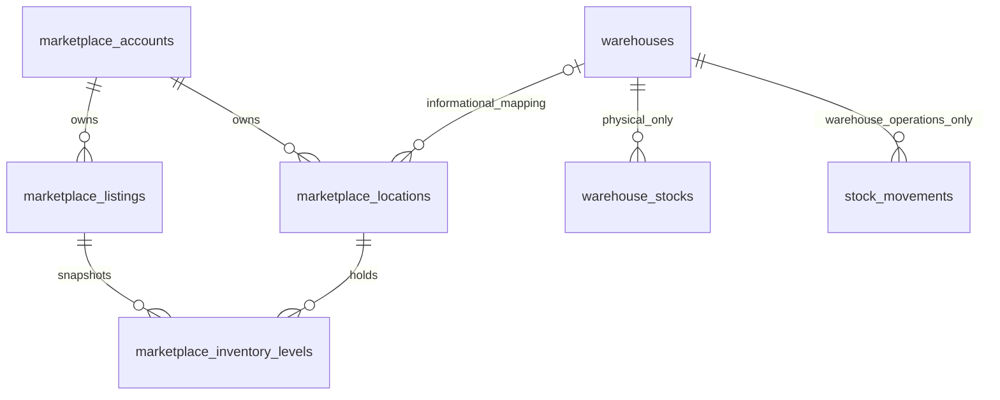

# TASK10 — общие внешние локации и остатки

Реализовано 12 ноября 2026 года после TASK8/TASK9. Shopify импортирует реальные остатки через прежний ShopifyClient и общую SyncMarketplace. WB/Ozon остаются demo. Физический складской учёт отделён от внешних снимков.

## Схема

stock_movements по-прежнему ссылается на warehouse/product, без связи с внешними снимками.

Миграция `2026_11_12_000006_generalize_marketplace_inventory.php` переименовывает существующие таблицы, не пересоздавая записи:

| Таблица | Изменение |
|---|---|
| shopify_locations → marketplace_locations | Сохранены все исходные поля, включая warehouse_id, seen_run, source_synced_at, is_active; добавлены metadata и timestamps |
| shopify_inventory_levels → marketplace_inventory_levels | Сохранены IDs, quantities, tracked, is_current и source dates; shopify_location_id переименован в marketplace_location_id; добавлены quantities JSONB, metadata, stale_reason и timestamps |
| shopify_locations / shopify_inventory_levels | Совместимые SQL views того же физического источника; legacy column alias shopify_location_id сохранён |

Внешняя локация уникальна по account/external_id, level — по listing/location. Существующие составные FK защищают account/location и organization/warehouse. Новый составной FK organization/account/listing закрывает возможность связать level с вариантом другого подключения той же организации. Добавлен индекс organization/account/is_current. inventory_item_id оставлен nullable как временный legacy alias; для нового провайдера он не обязателен. Shopify IDs хранятся в metadata и преобразуются адаптером.

Не изменялись таблицы физического учёта, каталог, пользовательский product mapping и история синхронизаций. Старые применённые миграции не редактировались. Rollback новой миграции отказывается удалять дополнительные поля при наличии внешних данных: обратный переход требует отдельной процедуры восстановления.

## Миграция и доказательство сохранности

Свежий backup находится вне Git, в `D:/ai/markethub-task10-backup-20261112`, под ACL текущего пользователя Windows и SYSTEM. Сохранены pg_dump custom и APP_KEY. Dump действительно восстановлен в отдельный cluster на loopback:55440. Сохранённым ключом успешно расшифрованы credentials. На восстановленной копии выполнена репетиция новой миграции. Временный PostgreSQL после проверки остановлен.

При остановленных worker/scheduler и отсутствии queued/running runs рабочая миграция применена во время краткого maintenance. Затем приложение возвращено в live, единые worker/scheduler TASK9 запущены снова. Reimport для миграции не выполнялся.

Контрольный снимок перед миграцией: 76 products, 3 подключения, 126 listings (26 Shopify и 100 demo), 17 внешних родителей, 3 locations, 28 levels, 6 sync runs, 1 локальный warehouse, 0 warehouse_stocks/stock_movements. После миграции значения сохранены. Проверены SHA256 **всех исходных столбцов 16 таблиц**, включая locations/levels через legacy aliases: все совпали. Это подтверждает прежние IDs, warehouse/product mapping, количества, tracked/current state, timestamps, credentials, историю и настройки. Подключение 15 сохранило manual и оба переключателя синхронизации.

Манифесты: before.json, restore-verified.json, rehearsal.json, after-migration.json. Они содержат хеши и результаты проверок; секреты не выводились в консоль и не включались в Git.

## Backend и контракт адаптера

Добавлены:

- `MarketplaceLocation`, `MarketplaceInventoryLevel` — tenant-aware модели с отношениями к account/listing/location/warehouse.
- `ExternalLocation`, `ExternalInventorySnapshot` — нормализованные immutable DTO без обязательных Shopify полей.
- `InventorySourceNormalizer` — дополнительный контракт адаптера остатков; существующий MarketplaceProvider не перегружен неподдерживаемыми методами demo.
- `MarketplaceInventoryService` — upsert локации, атомарная запись массива снимков, reconcileLocations, reconcileListing, stale.
- `MarketplaceInventoryQuery` — общие выборки по внешним локациям и demo без N+1.
- `MarketplaceInventoryController` — общие endpoints и безопасный warehouse mapping.

Изменены ShopifyProvider/ShopifyImporter, CatalogQuery, MarketplaceListingResource, StockController через общий query слой, CatalogExport, IndexRequest, MarketplaceAccount/MarketplaceListing relations, routes и OpenAPI. Физический InventoryQuery не получает внешние данные. ShopifyClient, выдача токена, throttling, pagination и очередь TASK9 не переписаны.

ShopifyProvider преобразует GraphQL location/quantities в DTO. Общий сервис не разбирает GID, GraphQL responses и inventoryItem queries. Дополнительные количества находятся в quantities, provider-specific атрибуты — в metadata. Legacy available/on_hand/incoming/committed поддерживаются для Vue.

## Upsert, fencing и полнота

Запись выполняется под execution lease текущего MarketplaceSyncRun и короткой блокировкой account. Несовпадающие org/account/target отклоняются. Устаревшая попытка не может записать данные даже после refresh Eloquent-модели. Проверяются source timestamps: более старый снимок вызывает безопасный retry вместо перезаписи нового. Существующие ID и warehouse_id сохраняются; auto mapping по имени отсутствует. HTTP выполняется вне транзакции.

Массив снимков сохраняется атомарно; один ошибочный элемент откатывает запись этой страницы. seen_run содержит reconcile_token попытки TASK9. Отсутствующие levels помечаются stale только после полного успешного обхода уровней соответствующего варианта. Частичный ответ не считается удалением. Инкрементальный импорт обновляет полученные данные и не сверяет отсутствующие варианты всего каталога. Полный обход locations может выключить отсутствующие locations и пометить их levels как location_missing. Point scope не выполняет глобальную сверку locations и не затрагивает чужие варианты.

При ошибке API значения не очищаются: затронутая область получает is_current=false / api_error. При удалении источника применяется source_deleted; после полного обхода отсутствующего level — missing; отключённая location получает location_inactive. Последний известный available остаётся доступен вместе со stale state. Успешно полученный свежий снимок снова актуален.

NULL означает неизвестное количество, 0 — известный ноль, отрицательное число сохраняется, tracked=false возвращается явно и делает available неизвестным. Дополнительные raw quantities не превращаются в physical stock. Совместимый stock_quantity cache listing сохраняет прежнее неотрицательное ограничение; canonical API читает подписанные значения levels, поэтому отрицательный внешний остаток не теряется в новом интерфейсе.

## API, mapping и отображение

Все пути имеют префикс `/api/v1` и требуют авторизации в активной организации:

| Метод | Путь |
|---|---|
| GET | /marketplace-accounts/{account}/locations |
| GET | /marketplace-accounts/{account}/inventory |
| PATCH | /marketplace-locations/{location}/mapping |
| GET | /marketplace-inventory |
| GET | /stocks |
| GET | /stocks/export |

`stocks` и `marketplace-inventory` используют одинаковый query слой: строка на реальный level либо одна недетализированная строка demo/local listing. Фильтры: provider/marketplace, account, location, поиск normalized external title/SKU/barcode и локальных полей, mapped/unmapped product, origin, tracked, is_current, location_active, наличие (zero/low/positive/negative/unknown), status, pagination и сортировка. Дополнительный стабильный ключ порядка — inventory ID. Ответ сохраняет прежний listing ID; составной UI key — listing ID + inventory_level_id. Добавлены quantities, источник, локация, mapping склада, stale reason и время снимка. Raw source и произвольная metadata не сериализуются.

Mapping принимает warehouse_id либо null. Проверяются права на account, принадлежность location, принадлежность warehouse той же организации и право чтения склада. Изменяется только информационная связь warehouse_id. Приёмка, движение, изменение warehouse_stocks и запись в Shopify не выполняются.

Legacy Shopify inventory/product detail/locations читают canonical tables; response shape и shopify_location_id сохранены. Sync history остаётся общим механизмом TASK9. Активного второго writer в старые таблицы нет.

На существующей странице «Остатки маркетплейсов» добавлены account/location filters, mapping склада, актуальность, поиск и nullable/negative presentation. Варианты без local product остаются видимыми и имеют ссылку на Shopify detail. Несколько locations отображаются отдельными строками. Полный редизайн не выполнялся.

WB/Ozon сохраняют demo stock_quantity без вымышленных locations и без HTTP. Происхождение явно отмечено demo. Для imported listing используется только inventory.available, а stock_quantity cache не складывается с levels. XLSX использует те же фильтры и дополняет прежние столбцы локацией, происхождением, актуальностью, tracked state и временем снимка; NULL остаётся пустой ячейкой, 0 и отрицательные значения — числами, текст защищён от Excel formula injection.

## Проверки

Итоговый backend: **147 passed, 1129 assertions** (изолированная PostgreSQL `_test`). TypeScript, ESLint и production build прошли. Playwright: **9 сценариев прошли** — Shopify + внешний inventory (2), physical inventory (1), procurement (1), onboarding (4), общий app CRUD/session/mobile (1). Все реальные браузерные fixtures теперь используют изолированную тестовую БД.

Дополнительно проверены атомарность страницы снимков, отклонение старого source timestamp и повторная сверка всех 16 контрольных хешей рабочей БД после read-only smoke: совпадение сохранено.

Общий Playwright app scenario также переведён с local DB на изолированную `_test` и отдельный server; обнаруженный необработанный reject загрузки фильтра подключений ProductsPage при logout исправлен.

Добавлены проверки upsert/IDs, нескольких locations и магазинов с одинаковыми external IDs/SKU, NULL/zero/negative/untracked, полноты/ошибки страниц, point scope, mapping/unmapping/IDOR, FK/unique, stale lease, bounded API queries, demo и exports. Реальный многопроцессный тест PostgreSQL подтверждает перекрытие двух writers, одну запись level, сохранение warehouse mapping и отсутствие physical movements. Проверка непустого physical stock сравнивает записи и историю до/после импорта.

Реальное read-only чтение Shopify: получены 2 текущие locations и один sample inventory level с tracked=true; mutation не выполнялась. Существующий локальный снимок из 3 locations намеренно не изменялся этим smoke. HTTP kernel smoke общих locations/inventory/stocks и старого Shopify inventory вернул 200; оба inventory API показали 28 levels. Новый sync run ради smoke не создавался.

## Ограничения

- Только Shopify является реальным адаптером; WB/Ozon API не добавлялись.
- Stale state отражает ошибки, неполноту и reconciliation; автоматический TTL снимков не введён.
- Locations endpoint возвращает весь список выбранного подключения для существующих фильтров UI; inventory endpoints пагинируются.
- Legacy views/columns и listing cache оставлены на переходный период. Удалять их следует отдельным этапом после миграции потребителей.
- Сохраняется ограничение TASK9 для очень больших каталогов: retry безопасно повторяет обход, отдельный bulk/chunk pipeline не добавлен.
- Обратная запись запасов, webhooks, заказы и полная унификация страниц не входят в TASK10.
