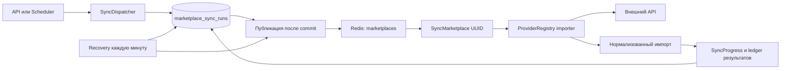

# TASK9: общая синхронизация площадок

Реализовано 12 ноября 2026 года. Shopify использует общий dispatcher, очередь, историю и scheduler; legacy API и сериализованные SyncShopify сохранены.

## Поток и данные

Физическая таблица shopify_sync_runs переименована в marketplace_sync_runs. Совместимое SQL view shopify_sync_runs читает ту же историю. Добавлены provider, scope, target_product_id, attempt, dispatch_state, даты публикации/lease/heartbeat, reconcile_token, checkpoint, attempt_progress и attempt_errors. Старые поля, UUID и target_listing_id сохранены. MarketplaceSyncResult хранит уникальный результат по run/kind/external_id; составные внешние ключи защищают организацию и подключение. Частичный unique index разрешает только один queued/running run на подключение.

Основные классы: MarketplaceSyncRun, MarketplaceSyncResult, SyncDispatcher, SyncMarketplace, SyncProgress, SyncException, MarketplaceSyncController, CheckMarketplaceSyncRuntime. ShopifyImporter и ShopifyClient используют общие heartbeat/checkpoint/counters, сохраняя транспорт и нормализацию Shopify. ShopifySyncRun, Shopify SyncDispatcher и SyncShopify служат совместимыми обёртками. ConnectionService, MarketplaceAccount, resources, console routes и настройки очереди переведены на общую историю.

## API

Все пути ниже имеют префикс /api/v1 и требуют авторизации и доступа к организации:

| Метод | Путь | Назначение |
|---|---|---|
| POST | /marketplace-accounts/{account}/sync | Создать или вернуть активный запуск |
| GET | /marketplace-accounts/{account}/sync-runs | История, фильтры и пагинация |
| GET | /marketplace-accounts/{account}/sync-runs/{run} | Прогресс и безопасные ошибки |
| GET | /marketplace-accounts/{account}/sync-status | Активный, последний и следующий запуск |
| POST | /marketplace-listings/{listing}/refresh | Точечное обновление варианта |

POST sync принимает confirm_initial_import, sync_products, sync_inventory, full_reconcile, scope и target_product_id согласно capabilities. Product scope доступен только провайдеру с refresh_product; Shopify сейчас поддерживает account и variant. Старые Shopify routes делегируют общему механизму. История и активный запуск хранятся в БД; страница товара восстанавливает polling после reload.

## Публикация, блокировки и recovery

Создание run и публикация в Redis не являются распределённой транзакцией. Run сначала фиксируется в PostgreSQL как pending, затем afterCommit захватывает короткую publishing lease и публикует UUID. Ошибка Redis оставляет pending с задержкой и безопасной диагностикой. Recovery повторяет публикацию; потерянная publishing lease восстанавливается через 90 секунд, старый published/queued — через 300 секунд. После 12 неудачных публикаций запуск завершается ошибкой с отсрочкой следующего расписания.

Recovery выбирает все активные runs, включая manual и незавершённый первоначальный импорт. Running с heartbeat старше 300 секунд восстанавливается только при получении PostgreSQL session advisory lock подключения. Живой worker с этой блокировкой не вытесняется. Worker повторно читает статус после блокировки. Короткие транзакции защищают изменения; внешние HTTP выполняются вне транзакции. Токен попытки дополнительно ограждает записи от устаревшего исполнителя, в том числе после refresh модели.

Retry сохраняет UUID. Максимум три попытки, задержки 60 и 300 секунд; worker_lost может быть восстановлен сразу. Итоговые counters основаны на уникальном ledger и не растут при повторном чтении тех же сущностей; attempt_progress показывает работу отдельной попытки. Ошибки прошлых попыток сохранены отдельно; успешный retry очищает текущую ошибку. Сообщения исключений провайдера и Redis с credentials не выдаются пользователю.

Scheduler сначала выполняет recovery, затем создаёт due hourly/daily runs только для активных и уже инициализированных подключений с поддерживаемыми типами данных. Manual не запускается автоматически. Точечный запуск не изменяет глобальные watermarks, initial_import_at и расписание.

## Checkpoint и безопасный обход

Checkpoint содержит фазу, cursor, область, попытку и признак завершения. Между попытками применяется replay_from_start: cursor служит диагностикой, а не обещанием стабильного снимка изменяемого каталога. Уникальный ledger устраняет повторный подсчёт. Архивация выполняется после полного успешного обхода области; отсутствие варианта дополнительно проверяется адресным запросом. Ошибка страницы не архивирует непосещённые записи, а обнаруженное изменение источника вызывает безопасный retry.

Ограничение: очень большой каталог, не укладывающийся в бюджет попытки, потребует отдельной реализации chunk/bulk sync. Возобновление с произвольного Shopify cursor между попытками намеренно не используется.

## Миграция и рабочие данные

Перед миграцией создан pg_dump и сохранён ключ приложения вне репозитория в защищённой ACL директории D:/ai/markethub-task9-backup-20261112. Backup реально восстановлен в отдельный PostgreSQL cluster на порту 55439; проверена расшифровка credentials. Затем проведена репетиция миграции на восстановленной базе. При краткой остановке постановки заданий и worker миграция применена к рабочей БД; приложение снова доступно.

SHA256 исходных столбцов всех 15 контрольных таблиц совпали до и после миграции. Сохранены 76 локальных товаров, 126 listings, 17 внешних родителей, 3 Shopify Locations, 28 Inventory Levels и все 5 исходных runs. Сохранённые UUID:

- a10b5151-bcf8-42b3-a83c-91d76712308f
- 17210c95-c054-448d-ad71-e8003e6c4a49
- cdafdb3b-1f37-422d-b621-81559d8e7e63
- 5ee8b302-38a4-44be-a4aa-03a56e4c3660
- 64fae450-0672-4997-b68e-a9e6e5f69763 (variant target 103)

После миграции выполнен реальный POST refresh варианта 103 через общий HTTP controller, Redis и SyncMarketplace. Run e893c7b4-9369-4f7e-a7fa-3ec165e63e16 завершился за 4 секунды с первой попытки: один вариант, один inventory, processed=2, ошибок=0. История теперь содержит 6 runs. Обновление внешнего снимка и времени проверки API ожидаемо изменило source timestamps. Повторная проверка хешей локальных products, warehouse_stocks, stock_movements и encrypted credentials после smoke test показала совпадение. Подключение 15 сохранило manual, sync_products=true, sync_inventory=true.

## Windows и проверки

scripts/marketplace-workers.ps1 управляет единым worker и scheduler; scripts/shopify-workers.ps1 делегирует ему. Worker читает marketplaces,shopify, поэтому старые задания также исполняются. PHP определяется через Get-Command или параметр PhpExecutable. Команда artisan marketplaces:sync-runtime проверяет durable connection и timeout/retry_after. В проверенной среде: Redis, timeout=1800, retry_after=1900, execution_budget=1500. На Windows бюджет проверяется между сетевыми операциями; зависший процесс требует контроля supervisor и recovery.

Проверки: artisan test — 129 passed, 1028 assertions; реальные многопроцессные PostgreSQL тесты manual/scheduled, full/point, duplicate workers, mapping/import и сбоя публикации после фактического commit включены. HTTP fakes покрывают transport retry, broken/mutable pagination, tenant isolation, переключатели, расписание и legacy API. TypeScript, ESLint и production frontend build прошли. Shopify Playwright сценарий прошёл при проверке интерфейса.

Не реализованы cancellation, webhooks, обратная синхронизация, заказы и реальные WB/Ozon API. Demo providers не создают фиктивных sync runs. Locations/Inventory Levels остаются Shopify-specific. Production deployment не выполнялся.
