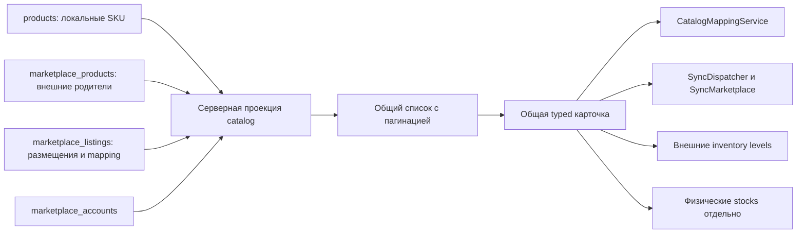

# TASK11 — единый каталог и интерфейс площадок

Реализовано 12 ноября 2026 года поверх TASK8–TASK10. Новых таблиц, переноса локальных SKU и изменения физических складов нет. Новые интерфейсы используют общие подключения, mapping, sync runs и inventory; Shopify остаётся реальным адаптером, WB/Ozon — demo.

## API и HTTP-слой

Добавлены `CatalogController`, `CatalogIndexRequest`, `UnifiedCatalogQuery`, `UnifiedCatalogPresenter`:

- `GET /api/v1/catalog` — серверная проекция products/marketplace_products/marketplace_listings/marketplace_accounts.
- `GET /api/v1/catalog/{kind}/{id}` — общая карточка с явно указанным типом идентификатора.
- `POST /api/v1/marketplace-connections/check` — проверка несохранённого подключения через `ConnectionService::probe` и необязательный контракт адаптера `ConnectionProbe`.

`GET /products` сохраняет прежнюю ответственность: локальные SKU для складов, ResourcePicker и закупок. Его ID не переопределён. Mapping/create-local-product, listing refresh, история/status, locations/inventory и account settings используют существующие controllers/services TASK8–TASK10. Очередь, importer и физический InventoryQuery не переписывались.

`ShopifyProvider` реализует `ProductLinks`: формирует ссылку Admin только после проверки shop_domain и Product GID. Общий контроллер не разбирает Shopify JSON или GID. Draft probe использует прежний ShopifyClient, не сохраняет account/credentials и не запускает импорт. Credentials остаются write-only; ошибки безопасны, endpoint имеет throttle 10/min. Сохранённое подключение проверяется прежним общим account/check.

`ConnectionReadService` пакетно читает статистику и последний run подключений страницы. `MarketplaceAccountResource` получает готовые агрегаты, без N+1 на каждый account. Совместимый alias shopify сохраняет legacy trigger serialization; integration использует общую историю. ShopifyController остаётся compatibility adapter; legacy HTTP contracts не удалены.

## Проекция каталога и идентичность

Строки имеют `key`, `kind`, `entity_id`:

| kind | Значение entity_id | Правило |
|---|---|---|
| local | products.id | Одна строка SKU со всеми связанными источниками, сколько бы размещений ни подходило фильтру |
| external_product | marketplace_products.id | Группа несопоставленных вариантов внешнего родителя |
| external_variant | marketplace_listings.id | Несопоставленный вариант без внешнего родителя; также тип адресной карточки варианта |

Сопоставленный вариант входит в local строку. Если часть вариантов родителя ещё не сопоставлена, внешний родитель остаётся в списке только для этой части. Полная карточка родителя показывает все его варианты и их индивидуальный mapping. Никакой Product ради отображения не создаётся.

SQL UNION ALL объединяет локальные строки и сгруппированные внешние источники; EXISTS фильтрует local без размножения строк join-ами. Сортировка имеет стабильные дополнительные ключи kind/entity_id. Поиск включает локальные и внешние названия/SKU, barcode, listing и parent external ID. Фильтры: provider/marketplace, account, kind, mapping, активность, demo/real, origin. Пагинация выполняется до загрузки данных страницы; Vue не фильтрует загруженный каталог целиком.

В списке максимум 100 строк, 8 previews источников на строку и одна фотография. Фото выбирается из доступных изображений всех previews, даже если первое размещение demo и без фотографии. Window functions ограничивают previews на стороне PostgreSQL; sources_count сообщает полный размер группы. Raw source_data не загружается в список и не сериализуется. Источники, родители, accounts, физические агрегаты, inventory и активные runs читаются пакетами. Новые индексы и миграции в TASK11 не потребовались.

## Страницы и общие компоненты

- `ProductsPage` использует `MarketplaceProductList` — тот же компонент встроен во вкладку товаров любого подключения.
- `CatalogDetailPage` обслуживает local, external parent и конкретный external variant. Старый local detail URL `/app/products/{id}` сохранён.
- `MarketplaceConnectionPage` обслуживает все провайдеры: обзор, товары, поддерживаемые остатки, настройки и поддерживаемая история.
- `MarketplaceConnectionForm` строит параметры по ProviderRegistry schema; одна кнопка «Добавить подключение» открывает общую форму.
- `ProductGallery` даёт 84px thumbnail, object-fit:contain, placeholder и увеличенный просмотр; detail gallery ограничена 12 фотографиями.
- `ProductMappingDialog` использует прежний ResourcePicker локальных SKU, mapping API и явное create-local-product с подтверждаемым SKU.
- `MarketplaceSyncHistory` читает общую историю TASK9 с фильтром и пагинацией.
- `MarketplaceStocksPage` используется самостоятельно и внутри подключения с фиксированным account; API и mapping остаются TASK10.

Общие клиенты: catalog.ts и connections.ts. Новые активные страницы не вызывают Shopify-only client и не выполняют GraphQL. Старые ShopifyPage/ShopifyProductPage и client оставлены для переходного периода, но больше не подключены как самостоятельный UI-процесс.

## Карточка, остатки и варианты

Карточка показывает галерею, описание, SKU, barcode, source status, локальную цену и отдельные цены каждого размещения, магазин, дату снимка, внешний Admin URL и индивидуальные варианты. Есть ссылки между parent, variant, local SKU и общим подключением.

`physical_stocks` и `inventory` — отдельные блоки и отдельные поля контракта. Для mapped external detail физические stocks дополнительно подписаны локальной SKU. Неизвестный available, tracked=false, stale и неактивная location отображаются явно. Последние известные внешние снимки не суммируются с физическим наличием.

Размещения карточки пагинируются по 20; inventory возвращает до 200 levels текущей страницы с inventory_total и переходом к полному inventory API. Физический блок ограничен 100 строками; локальная карточка содержит переход к полному складскому списку. В списке и карточке source quantities представляют внешние снимки, а не физические операции.

Складские/закупочные действия доступны только через local product ID. Внешний entity_id или listing ID не передаётся как products.id. ResourcePicker продолжает читать `/products`, поэтому несопоставленный внешний вариант нельзя случайно выбрать как единицу физического учёта.

## Refresh и сопоставление

«Обновить из источника» доступно по refresh_listing capability и отправляет POST общего listing/refresh. В интерфейсе явно указан конкретный вариант; кнопка не обещает обновление всей группы. Статус опрашивается через account/sync-runs/{UUID}. После реального завершения карточка перечитывается; partial/failed показывают ошибку и ссылку на историю. При reload активный run восстанавливается из detail API. Номер страницы вариантов хранится в URL (sources_page), поэтому восстановление работает и для варианта на второй и следующих страницах. При недоступной очереди UI не имитирует успех.

«Открыть в Shopify Admin» является внешней ссылкой. «Сопоставить с MarketHub» открывает выбор конкретной local SKU либо явное создание с SKU. «Отменить сопоставление» изменяет только связь; физические данные и source snapshot остаются прежними. Коллизия SKU и cross-organization ID проверяются существующими сервисами. Показаны подтверждения успешных действий. Кнопки ResourcePicker «Назад» и «Далее» проверены на двух страницах выбора SKU.

## Подключения и совместимость

Одна форма создания выбирает провайдера и его параметры, позволяет проверить поддерживаемый API до сохранения и после сохранения открывает общую страницу подключения. Demo явно обозначен без фиктивного check/sync. Settings изменяются только по нажатию «Сохранить настройки»; загрузка страницы не перезаписывает manual/hourly/daily или toggles. Новые Shopify подключения используют существующие defaults hourly/true/true.

Старые Vue URL `/app/marketplaces/shopify/{account}` и `/products/{listing}` под ним перенаправляются на общие маршруты с сохранением query. Существующие Shopify HTTP endpoints, Jobs и history UUID остаются рабочими. Полное удаление legacy backend/client code отложено до миграции внешних потребителей.

## UX, маршруты и обучение

Фильтры каталога сохраняются в URL и корректно перечитываются при повторном использовании компонента и browser back. Инициализация фильтров перенесена до mount, чтобы не перезаписать быстрый пользовательский ввод. Return link карточки сохраняет фильтры списка. Есть loading/error/empty states, ясные названия действий и отдельные статусы очереди/ошибок. Settings имеют единый grid с согласованными отступами и шириной. Таблицы прокручиваются внутри контейнера, mobile layout не расширяет документ.

Обновлены существующие tours products/marketplaces/shopify, версии повышены до 2. Неверный shopify-connect заменён на create-marketplace. Добавлены объяснения фильтров, mapping и точечного refresh. Подсветка привязана к компактным заголовкам и конкретным фильтрам, чтобы рядом помещалась подсказка. Продолжение экскурсии из Help явно возвращает на маршрут нужного шага; отсутствующие бизнес-записи не создаются ради обучения. Сохранены skip/restart/progress и работа «Назад»/«Далее».

## Проверки и сохранность

Итоговый backend: **159 passed, 1233 assertions**. TypeScript typecheck, ESLint и production build прошли. Playwright: **14 сценариев прошли** — общий каталог/Shopify/inventory/compatibility (6), общий app CRUD/session/mobile (1), physical inventory (1), procurement (1), onboarding и действительные Shopify anchors (5). Backend и браузерные destructive fixtures запускались на изолированной PostgreSQL `_test`; итоговые прогоны выполнены последовательно.

Новые Feature Tests проверяют группировку, отсутствие дублей local, normalized поиск, account/provider filters, серверную пагинацию, preview limits, typed detail, gallery/Admin links, mapping/unmapping/create SKU, current run после reload, tenant isolation, отсутствие raw payload и ограниченное число запросов. Отдельно проверены физические 12 шт. и внешние 7 шт., без сложения и дополнительных движений; draft probe не сохраняет credentials или account.

Новые/обновлённые Playwright сценарии покрывают общий каталог и gallery/mobile, variant refresh/reload, ResourcePicker pagination/mapping/unmapping/SKU collision, общую форму проверки/сохранения, manual/hourly/daily, первоначальное подтверждение импорта, общий connection catalog/history и обновлённые tour anchors. Складские, закупочные и прочие onboarding регрессии остаются на изолированной PostgreSQL `_test`; рабочая БД не очищается.

Реальный read-only HTTP kernel smoke: `/products` и `/catalog` возвращают все 76 текущих локальных товаров, Shopify filter — 26 local строк с Shopify sources; typed local/variant detail и общее подключение отвечают 200. Raw source_data в этих ответах отсутствует. Account 15 остался manual/true/true. Хеши исходных столбцов всех 16 контрольных таблиц совпали со снимком TASK10, включая product mapping, credentials, inventory и history. Импорт ради UI-рефакторинга не запускался; данных магазина не меняли.

## Ограничения

- Реальное подключение пока только Shopify; WB/Ozon честно остаются demo.
- Dashboard по-прежнему использует прежние метрики local SKU; аналитика не перерабатывалась.
- Галерея и source previews намеренно ограничены; полный вариантный список доступен с пагинацией.
- Legacy Shopify HTTP shapes сохранены для совместимости. Новый пользовательский UI читает только нормализованные общие ответы.
- Большие каталоги сохраняют ограничения replay/chunking TASK9; новый sync pipeline не создавался.
- Заказы, webhooks, финансы, обратная запись inventory и production deployment не входят в этап.
