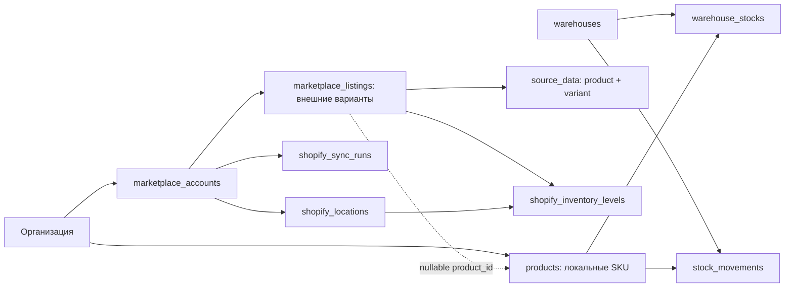
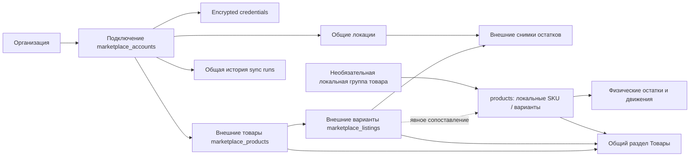

# Этап 1/7. Аудит объединения торговых площадок MarketHub

Дата: 12 ноября 2026. Источник задания: `D:/Projects/STEP1.md`.

## 1. Границы проверки и основной вывод

Проверены текущая рабочая копия Laravel/Vue, миграции, модели, маршруты, сервисы, политики, frontend и тесты. Проверена фактическая PostgreSQL-схема и агрегаты данных в транзакции `REPEATABLE READ, READ ONLY`, завершённой `ROLLBACK`. Снимок БД: **2026-11-12 09:33:14 UTC**. Секреты, токены и содержимое credentials-файла не выводились. Запросы в Shopify, импорт, миграции, перезапуск процессов и изменение настроек в рамках аудита не выполнялись.

Создан только этот документ. Уже существующие незакоммиченные изменения Shopify являются исходным состоянием аудита; их наличие не означает, что они реализованы на этом этапе.

**Общий фундамент уже есть:** организации, подключения, каталог, размещения, складской учёт, Sanctum и политики. Создавать их заново не требуется. Основная проблема — общие сущности имеют несколько разных путей чтения и изменения, а импорт, состояние подключения, история и UI организованы как отдельная вертикаль Shopify. Простое переименование Shopify-классов этого не исправит.

Целевое решение: сохранить `marketplace_accounts`, `products` и `marketplace_listings`; выделить общие внешние товары, локации, снимки остатков и запуски; перенести управление процессом в общие сервисы, оставив протокол Shopify в адаптере. Общий раздел «Товары» должен представлять локальные SKU вместе с внешними вариантами, включая несопоставленные, а не только строки `products`.

## 2. Что действительно находится в базе

| Объект | Состояние на момент снимка |
| --- | --- |
| Драйвер / timezone | PostgreSQL / `Europe/Minsk` |
| Очередь / кеш приложения | Redis / Redis |
| Организация с каталогом | ID 1 |
| `products` | 76 записей: 50 ранее существовавших и 26 связанных с Shopify |
| WB, подключение 1 | demo; 50 размещений, 50 связанных локальных товаров |
| Ozon, подключение 2 | demo; 50 размещений, те же 50 локальных товаров |
| Shopify, подключение 15 | active, реальные данные; 26 размещений, 26 связанных локальных товаров, 17 разных Product GID |
| Несопоставленные Shopify-размещения | 0 сейчас; схема и сценарии импорта допускают их появление |
| Shopify-остаток в агрегате размещения | У одного варианта `NULL` |
| `shopify_locations` / `shopify_inventory_levels` | 3 / 28 записей |
| `shopify_sync_runs` | 5 записей |
| `warehouse_stocks` / `stock_movements` | 0 / 0 записей |
| Дубликаты `(marketplace_account_id, external_id)` при ненулевом ID | Не найдены |
| Настройки Shopify 15 | **manual**, оба типа данных включены, первый успешный импорт есть |

Важно: действующее подключение сейчас настроено пользователем на `manual`. Это не неисправность Scheduler. Нельзя возвращать ему `hourly` при рефакторинге. `hourly` остаётся значением по умолчанию для новых подключений.

Все 13 существующих миграций применены, включая `2026_11_12_000001_add_shopify_integration`, `000002_add_shopify_run_counters`, `000003_add_shopify_target_listing`. Отдельных таблиц `product_variants`, `shopify_products`, `shopify_variants`, общего реестра провайдеров и общих `marketplace_sync_runs` сейчас нет.

### 2.1. Отличие текущего состояния от описания исходных проблем

| Утверждение | Результат проверки текущей копии |
| --- | --- |
| Shopify подключается отдельной кнопкой | Уже исправлено в UI: общая форма `MarketplacesPage.vue`, выбор Shopify, credentials. Но запрос всё ещё уходит в отдельный Shopify API |
| Остатки Shopify вообще исключены из общего раздела | Уже исправлено для `GET /stocks` и его экспорта. Общий CRUD размещений продолжает их исключать |
| Реальные товары Shopify отсутствуют в основной таблице | Не подтверждено: 26 записей `products` связаны с Shopify. Несопоставленные внешние варианты общий каталог по-прежнему не представляет |
| Нет отдельной карточки и точечного обновления | Уже добавлены `ShopifyProductPage.vue`, GET карточки и POST refresh; это всё ещё отдельный Shopify-сценарий |
| Пагинация сопоставления ничего не делает | Код теперь показывает видимый список `ResourcePicker` с `expanded`, страницы меняются. Требуется сохранить поведение в общем UI |
| Маленькие изображения и отступы настроек | В текущем коде превью 96 px, галерея 400/300 px, scoped CSS настроек. Это локальные исправления, не общий компонент/стандарт |

Повторно воспроизводить уже устранённые дефекты как актуальные было бы неверно. Ниже отдельно указаны подтверждённые ограничения и риски, выведенные из кода.

## 3. Текущая схема и отношения

### 3.1. Общие сущности

| Таблицы | Смысл и связи | Источник |
| --- | --- | --- |
| `organizations`, `organization_user`, `users.active_organization_id` | Пользователь состоит в организациях; активный tenant определяется с проверкой членства | `database/migrations/2026_11_10_000002_create_organization_catalog.php`, `app/Support/OrganizationContext.php` |
| `marketplace_accounts` | Подключение принадлежит организации; `marketplace`, `name`, `status`, `is_demo`; hasMany размещений | Та же миграция, `app/Models/MarketplaceAccount.php` |
| `products` | Локальная учётная SKU: название, обязательный SKU, описание, базовая цена, валюта, активность. Уникальность `(organization_id, sku)` | Та же миграция, `app/Models/Product.php` |
| `marketplace_listings` | Размещение/внешний вариант подключения; nullable `product_id` связывает с локальной SKU; цена и остаток площадки | Та же миграция и Shopify-расширение |
| `warehouses`, `warehouse_stocks`, `stock_movements` | Физический склад, остаток `(org, warehouse, product)`, неизменяемое движение. Склады типа `marketplace` тоже являются сущностями физического учёта, а не импортированными Locations | `2026_11_11_000001_create_warehouse_inventory.php` |
| `suppliers`, `purchase_orders`, `purchase_order_items`, `goods_receipts`, `goods_receipt_items` | Закупки и приёмки с FK к прежним `products.id`; подтверждение связано со складскими движениями | `2026_11_11_000002_create_procurement.php` |
| `user_tour_progress`, настройки в `users` | Персональный прогресс `(user_id, tour_id, version)`; не данные магазина | `2026_11_11_000003_create_user_onboarding.php` |
| `jobs`, `job_batches`, `failed_jobs`, `cache`, `cache_locks` | Общая техническая инфраструктура Laravel; при Redis таблица `jobs` не является основной очередью | Системные миграции `0001_01_01_*` |

Цены каталога и размещений — integer minor units, разрешены RUB/USD/EUR/BYN/KZT/CNY/GBP. Отдельной сущности истории цен или таблицы вариантов нет. Цены закупок — decimal; этот формат нельзя автоматически распространять на API каталога.

`Product` связан с размещениями, остатками, движениями и строками закупок. `Organization` имеет коллекции каталога, подключений, складов, закупок и приёмок. `MarketplaceListing` belongsTo `Product` и `MarketplaceAccount`. `WarehouseStock` belongsTo склад и продукт; `StockMovement` — склад, продукт, пользователь и связанная строка приёмки. Модели документов связывают поставщика, склад, товары и пользователей создания/подтверждения.

### 3.2. Shopify-расширение

`2026_11_12_000001_add_shopify_integration.php` добавляет в общую таблицу подключений `shop_domain`, зашифрованные `shopify_client_id`/`shopify_client_secret`, расписание, переключатели, времена синхронизации и состояния API. Домен уникален в организации. В размещения добавлены `source_data` JSONB, `source_status`, `source_synced_at`, `source_seen_run`; `product_id` и `stock_quantity` стали nullable.

В `marketplace_listings.external_id` находится **Variant GID**, не Product GID. Product GID и metadata лежат внутри `source_data.product`; InventoryItem GID — в `source_data.variant.inventoryItem`. Данные родителя и изображения повторяются в JSON каждого варианта. Цена варианта также вынесена в `price_minor`. Родительский внешний товар не имеет отдельной нормализованной записи.

| Таблица | Текущая роль и ограничения |
| --- | --- |
| `shopify_sync_runs` | UUID, org/account, параметры запуска, status/trigger, счётчики, ошибки, timestamps. Частичный unique index разрешает только один queued/running на account |
| `shopify_locations` | org/account/external ID, имя, active, nullable `warehouse_id`, время и UUID обхода; unique `(account, external_id)` |
| `shopify_inventory_levels` | Внешний снимок variant/listing + location; available/on_hand/committed/incoming, tracked, source timestamps, `is_current`; unique `(listing, location)` |

Миграция `000002` добавляет отдельные счётчики товаров/вариантов/inventory items, `000003` — nullable `shopify_sync_runs.target_listing_id`.

В PostgreSQL подтверждены составные FK размещений к `(organization_id, product_id)` и `(organization_id, marketplace_account_id)`, FK локации к org/account и локальному складу, FK уровней к org/listing и org/account/location. **Пробелы:** FK target запуска содержит только `listing_id`; связь inventory level с listing не включает account. Текущие endpoints проверяют account, но сама БД не запрещает неправильное связывание таких записей внутри одного tenant; для target FK также нет проверки tenant на уровне БД.

Уникальность размещений:

- `(marketplace_account_id, external_id)` защищает повторный импорт внешнего варианта;
- `(product_id, marketplace_account_id) WHERE source_data IS NULL` сохраняет прежний инвариант локальных WB/Ozon-размещений;
- наличие JSON используется как неявный признак типа размещения. Это не полноценное поле происхождения и плохо расширяется на других провайдеров.

## 4. Карта реализации и API

### 4.1. Backend

| Код | Ответственность сейчас | Решение при объединении |
| --- | --- | --- |
| `app/Models/{Organization,Product,MarketplaceAccount,MarketplaceListing}.php` | Общие сущности | Сохранить ID и связи, расширить contracts/relations |
| `app/Services/CatalogQuery.php` | Разные выборки каталога и размещений | Разделить явные запросы локального каталога, внешних вариантов и общего представления |
| `app/Services/StockOperationService.php`, `ProcurementService.php`, `InventoryQuery.php` | Физический учёт и закупки | Переиспользовать без подключения внешнего импорта к операциям склада |
| `app/Services/Shopify/ShopifyClient.php` | Client credentials, токен, GraphQL, страницы, retries/throttle | Оставить API-специфику в Shopify-адаптере |
| `app/Services/Shopify/ShopifyImporter.php` | Проверка API, чтение Shopify, создание local SKU, upsert размещений, inventory, удаления, counters, завершение runs и расписание | Разделить адаптер чтения и общий процесс сохранения/синхронизации |
| `app/Services/Shopify/SyncDispatcher.php` | Очередь, дедупликация, расписание, восстановление зависших jobs | Превратить в общий dispatcher/recovery без фильтра только Shopify |
| `app/Jobs/SyncShopify.php` | Выполнение, advisory lock, retries и безопасное завершение | Общий job по UUID запуска; временно сохранить класс для уже сериализованных заданий |
| `app/Models/ShopifySyncRun.php` | История без tenant trait и Eloquent relations; org фильтруется вручную | Общая tenant-aware модель запуска с явными связями |
| `app/Http/Controllers/Api/V1/ShopifyController.php` | Connection CRUD, check/sync, списки, detail/refresh/map/history | Общие controllers/use cases; provider определяется по account |
| `ShopifyConnectionRequest.php`, `ShopifyIndexRequest.php` | Специальная валидация | Общая оболочка + правила credentials/capabilities провайдера |
| `MarketplaceAccountRequest.php`, `MarketplaceListingRequest.php` | Общий CRUD явно отказывает Shopify | Снять расхождения через общую бизнес-логику, сохранив запрет произвольной правки внешних snapshots |
| `MarketplaceAccountResource.php`, `ProductResource.php` | Ветви `shopify`, `shopify_listings`; SQL внутри resource | Общие поля integration/source; агрегаты получать до сериализации |
| `app/Console/Commands/ConnectLocalShopify.php` | Локальная утилита чтения существующего credentials-файла; выбирает организацию, сохраняет encrypted поля и проверяет API | Не бизнес-основа интеграций. Оставить временным compatibility wrapper общего сервиса подключения |

Класса **`ShopifyService` нет**; фактические классы — `ShopifyClient`, `ShopifyImporter`, `SyncDispatcher`. Реальных клиентов/импортёров WB и Ozon нет. `database/seeders/DemoDataSeeder.php` создаёт их демонстрационные товары/размещения, а не вызывает API площадок.

### 4.2. Действующие HTTP endpoints

Все перечисленные бизнес-маршруты находятся под `/api/v1` и `auth:sanctum` в `routes/api.php`.

| Группа | Пути и методы |
| --- | --- |
| Общие подключения | GET/POST `/marketplace-accounts`; GET/PATCH/DELETE `/marketplace-accounts/{account}`. POST/PATCH Shopify отвергаются общим Request; DELETE Shopify отвергается controller |
| Локальный каталог | GET/POST `/products`; GET/PATCH/DELETE `/products/{product}`; GET `/products/export` |
| Общие размещения | GET/POST `/marketplace-listings`; GET/PATCH/DELETE `/marketplace-listings/{listing}`. Index исключает импортированные; изменение/удаление source-размещений защищено |
| Остатки площадок | GET `/stocks`, `/stocks/export`; здесь source-размещения уже включены |
| Shopify | POST `/shopify/connections`; GET/PATCH `/shopify/connections/{account}` |
| Проверка/импорт | POST `/shopify/connections/{account}/check`, `/sync`; первый полный импорт требует `confirm_initial_import` |
| Shopify-каталог | GET `.../{account}/products`, `.../products/{listing}`; POST `.../products/{listing}/refresh`; PATCH `.../products/{listing}/mapping` |
| Shopify-остатки/история | GET `.../{account}/inventory`, `/locations`, `/runs`, `/runs/{uuid}` |
| Физический склад | GET/POST `/warehouses`, GET/PATCH `/warehouses/{warehouse}`; GET `/warehouse-stocks`, `/warehouse-stocks/summary`, `/stock-movements`; POST `/stock-operations` |
| Onboarding | GET `/onboarding`, `/onboarding/checklist`; PATCH `/onboarding/preferences`, `/onboarding/tours/{tour}` |

Закупочные endpoints `/suppliers`, `/purchase-orders`, `/goods-receipts` и их document actions сохранены; к внешней синхронизации они отношения не имеют. Авторизация/организации: `/auth/me`, `/organizations`, `/organizations/active`, cookie login/logout в `routes/web.php`. Публичные `/system-checks` содержат только технические записи.

### 4.3. Frontend и обучение

Маршруты определены в `frontend/src/router/index.ts`:

- `/app/marketplaces` → `MarketplacesPage.vue`: общая форма подключения, но Shopify выбирает другой API и отдельную страницу управления; счётчики каналов всё ещё запрашивают только Ozon/WB.
- `/app/products`, `/new`, `/:id`, `/:id/edit` → `ProductsPage.vue`, `ProductFormPage.vue`, `ProductDetailPage.vue`: локальный каталог и формы; `shopify_listings` отдельно добавлены в отображение.
- `/app/marketplace-stocks` → `MarketplaceStocksPage.vue`: общие внешние агрегаты, Shopify option уже есть; `/app/stocks` → `StocksPage.vue`: физические склады/остатки и ссылка на внешние данные.
- `/app/marketplaces/shopify/:id` → `ShopifyPage.vue`: обзор, products, inventory, settings, history; сохраняется отдельная архитектура UI.
- `/app/marketplaces/shopify/:id/products/:listing` → `ShopifyProductPage.vue`: отдельная галерея, mapping, point refresh и polling запуска.
- `/app/marketplaces/shopify/new` уже redirect на `/app/marketplaces?connect=shopify`, однако внутри `ShopifyPage.vue` ещё остаётся собственная ветка `creating` и форма создания. Это не второй доступный главный вход, а лишний поддерживаемый код.

API-клиенты разделены между `frontend/src/api/{products,marketplaces,stocks,shopify}.ts`. `frontend/src/types/index.ts` и `api/shopify.ts` содержат общие и Shopify-специфичные типы. `ResourcePicker.vue` переиспользуется в документах и mapping; вариант `expanded` теперь делает результат пагинации видимым.

Onboarding использует общий `TourProgressService`, `OnboardingController`, `useProductTour.ts`, компоненты `TourHost/Overlay/Tooltip/Launcher` и конфиг `features/onboarding/config/tours.ts`. Семь сценариев, включая Shopify. Чек-лист пока состоит из организации, склада, товара, поставщика, закупки и подтверждённой приёмки; подключение/первый импорт отдельным шагом не представлены. Прогресс персональный, а чек-лист читает текущую организацию; смешивать эти области хранения не следует.

## 5. Конкретные проблемы и причины

### 5.1. Видимость товаров: две разные сущности выданы за одну

`CatalogQuery::productQuery()` начинается с `Product::query()`. `ProductController::index()` и `ProductsPage.vue` используют только этот набор. Фильтр `whereHas('listings')` находит локальные товары с внешними связями, но **не может вернуть размещение с `product_id = NULL`**.

`ShopifyImporter::variant()` создаёт локальный товар при первом импорте, если SKU не конфликтует. При совпадении SKU автоматического связывания нет: сохраняется несопоставленное размещение. Inventory-only импорт также не создаёт local SKU. Уже существующая несопоставленная запись при дальнейшем product sync автоматически local SKU не получает. Поэтому «все внешние товары в общем разделе» не выполнено даже при наличии реальных записей в `products`.

Кроме того, локальные название, описание и базовая цена намеренно не перезаписываются повторным импортом. Изменение цены в Shopify обновит размещение, но основная колонка цены общего каталога останется локальной. Поиск в общем каталоге идёт по локальным `name/sku`, а не по свежим внешним значениям. Это объясняет ощущение, что свежие товары/изменения не попали в CRM, без утверждения об отсутствии записей в БД.

**Решение:** единое представление каталога с явным различием local/source полей и несопоставленными вариантами. Не заполнять `products` фиктивными строками только ради видимости и не подменять внешними данными пользовательские локальные поля.

### 5.2. Остатки и размещения читаются по разным правилам

`CatalogQuery::listingQuery($request, $includeSources = false)` по умолчанию ставит `product_id IS NOT NULL AND source_data IS NULL`. Это продолжает скрывать Shopify из общего index размещений и из `listings_url`, который возвращают `ProductResource` и `MarketplaceAccountResource`.

`StockController` и `ExportController::stocks()` уже передают `true`, поэтому текущие `/stocks` и Excel включают Shopify. Это исправление конкретного пути, не единый контракт чтения. Поиск `/stocks` всё ещё проверяет локальный продукт и `external_id`, но не внешнее название/`external_sku`: несопоставленный вариант виден без фильтра и может исчезнуть при поиске по своему названию или SKU.

Агрегат `marketplace_listings.stock_quantity` не заменяет уровни локаций: дополнительные категории, `is_current` и источник времени находятся отдельно. Общая страница показывает агрегат, Shopify-страница — локации. `NULL` и отрицательные available нельзя преобразовывать в физический ноль; отрицательный снимок допустим у источника, локальный агрегат сейчас неотрицателен либо null.

### 5.3. Внешняя модель не отделена от JSON и от правил local CRUD

Внешний Product ID, описание, изображения и атрибуты варианта читаются по Shopify-путям JSON. `ProductResource` называет любые загруженные source-размещения `shopify_listings`, не проверяя реальный provider. Новая интеграция потребует изменений controllers, requests, resources, SQL, TS и Vue.

`CatalogRules::listing()` требует non-null local product, stock и уникальную пару local product/account даже для source-данных; схема Shopify разрешает иное. Импорт обходит Eloquent и пишет через `DB::table`, поэтому эти правила не применяются. Нужны отдельные правила локального размещения и общего source snapshot, а не дальнейшее накопление обходов.

### 5.4. Импорт выполняет слишком много разных бизнес-действий

`ShopifyImporter` одновременно занимается transport mapping, local product creation, внешним upsert, удалениями, inventory, счётчиками, историей и расписанием. Адаптер должен возвращать нормализованные данные и полноту обхода, а общие сервисы — сохранять их и принимать решения о связывании/локальном создании.

Сам `marketplace === 'shopify'` в Shopify-адаптере не дефект. Проблема — такая проверка в общих бизнес-сценариях и необходимость копировать процесс для каждой новой площадки.

Список провайдеров также закреплён в `MarketplaceAccount::MARKETPLACES`, PostgreSQL `accounts_values_check` и frontend selectors/types. При добавлении провайдера потребуется согласованно обновить registry, разрешённые коды/валидацию и capabilities. Не следует обещать подключение произвольной площадки только добавлением одного класса без проверки схемы и UI.

### 5.5. Идентичность и риск дублей

Повторный импорт того же Variant GID в том же account защищён unique constraint, upsert и account lock. В текущих данных дубликатов внешних ключей нет. Поэтому утверждение «каждый повторный импорт обязательно создаёт дубликаты» неверно.

Но local SKU и внешний вариант — разные идентичности. Удалённый и заново созданный в Shopify вариант имеет другой GID; смена магазина/организации тоже меняет область идентичности. Одинаковые SKU в двух магазинах не должны автоматически объединяться. Сегодня второй магазин при совпадении SKU создаст несопоставленное размещение; это безопасно, но требует UI, который показывает его в общем каталоге. Старые local products после удаления источника сохраняются — намеренно, без автоматического объединения/очистки.

### 5.6. Изоляция организаций работает на API, но не полностью выражена в схеме

`BelongsToOrganization` ставит global scope, `OrganizationContext` проверяет членство, `OrganizationBusinessPolicy` используется общими моделями; Shopify controller дополнительно проверяет account и org в запросах. Worker снимает global scope с account, но указывает org из run.

У `ShopifySyncRun` global scope/relations нет, таблицы locations/levels читаются Query Builder. Сейчас безопасность зависит от каждого ручного `where`. Составные FK для run target и level/listing/account следует усилить, а общие write services обязать принимать org/account вместе. Политики по ролям «просмотр/управление интеграцией» пока нет: членство даёт общие разрешения; не следует описывать текущую систему как полноценную RBAC.

Есть риск потери ручного mapping при конкуренции: `map()` блокирует строку, а импорт читает прежний `product_id` без row lock и затем пишет его обратно в составе source update. Это вывод из последовательности SQL, не воспроизведённая атака. Общий upsert не должен перезаписывать mapping существующей записи; изменение связи — отдельная транзакционная операция.

### 5.7. Общие проблемы выполнения jobs

Положительное: enqueue под account row lock, partial unique index активного run, dispatch after commit; worker использует PostgreSQL advisory lock, 3 попытки и timeout 1800 секунд. `ShopifyClient` обновляет токен при 401, ограничивает сетевые/429/5xx/GraphQL retries, пагинирует и проверяет продвижение cursor. Полные/инкрементальные обходы и point refresh уже реализованы.

Оставшиеся риски:

- Recovery зависших jobs встроен в выборку **due hourly/daily** подключений. Для `manual`, выключенного account или не завершившего первый импорт восстановления этой веткой нет. Зависший queued/running может блокировать ручной повтор бесконечно.
- Публикация в Redis после commit и создание записи run в PostgreSQL не атомарны: если отправка не удалась после commit, run останется queued. Нужны явное восстановление pending-dispatch и периодическая проверка, а не предположение об exactly-once delivery.
- При retry сохраняются прежние counters/errors; повторная обработка может завысить обработанные/обновлённые количества и сохранить старую ошибку после успешной новой попытки. У данных и истории разные требования к идемпотентности.
- Одно задание обходит весь магазин, а images одного продукта собираются в массив. Есть пагинация, но нет durable cursor/checkpoint. Для больших каталогов 30 минут — реальное ограничение; повтор начинает значительную часть работы заново.
- Состояние API обновляется при check, но критическая ошибка последующей секции не обязательно переводит `api_status` из connected. Нужно различать «последняя проверка», «последний успех» и «последняя попытка».
- Point run получает `full_reconcile` из состояния account, хотя полной сверкой не является. Это может дать неверную подпись в истории; общий run должен хранить явный scope `connection`/`listing`.
- Перед исполнением после получения advisory lock желательно перечитывать статус run: первоначальная проверка выполняется до lock. Реальная конкурентная доставка Redis отдельно не проверена текущим fake-набором.

### 5.8. UI, навигация и экскурсии

Первоначальная пагинация `ResourcePicker` листала options закрытого select: пользователь не видел изменения. Текущие expanded options это устраняют. Кнопки пагинации корректно disabled на границах. Не следует путать их с «Назад/Далее» экскурсии.

Конкретная оставшаяся ошибка обучения: в `features/onboarding/config/tours.ts` шаг `shopify.connection` ссылается на **`target('shopify-connect')`**, а отдельный элемент с этим `data-tour` уже удалён из `MarketplacesPage.vue`. Общая кнопка имеет `create-marketplace`. Движок умеет безопасно работать без target, но подсветки нужного действия не будет. Следующие Shopify-шаги в основном текстовые, не переводят пользователя к реальному account/tab. Общий marketplace first-visit может также конкурировать с более специальным Shopify-предложением из-за порядка registry; проверить при объединении.

Отступы и фотографии ранее задавались отдельной разметкой без общего layout формы/карточки. Текущие scoped CSS и галерея исправляют локальное отображение; далее следует переиспользовать один layout, не менять глобальный дизайн.

Дополнительные ограничения: фильтры source/account в `ProductsPage.vue` инициализируются из URL, но изменение этих query при повторном использовании того же component явно не отслеживается; загрузка списка account в onMounted не имеет собственного catch. `ShopifyProductPage` хранит UUID выполняющегося refresh только в памяти и при reload не восстанавливает его. Общие страницы/ресурсы должны получать состояние выполнения из API, а не только из результата клика.

### 5.9. Нагрузочные и эксплуатационные вопросы

`MarketplaceAccountResource::shopifySummary()` выполняет две дополнительные выборки на каждый Shopify account: статистика и последний run. Это потенциальный N+1, установленный по коду, не результат профилирования. JSON родительских изображений повторяется по вариантам, и общий каталог eager-load всех source-размещений может увеличивать ответ.

`routes/console.php` запускает `shopify:dispatch-due` каждую минуту. `scripts/shopify-workers.ps1` создаёт два скрытых процесса: Redis worker очереди `shopify` и `schedule:work`; hardcoded PHP path, ручной PID tracking, общего управления integrations нет. Статус во время аудита: оба процесса работают. Они не перезапускались. Запуск скриптом не означает установленного Windows autostart/service supervision. Default очереди в config — database, фактическое `.env` выбирает Redis; для database `retry_after=90` не согласован с 1800-секундным Shopify job. Объединение должно явно закрепить используемую очередь и её timeout/retry_after.

## 6. Credentials, токены и второй Shopify-магазин

В `MarketplaceAccount` оба поля credentials скрыты из serialization и имеют Laravel cast `encrypted`. В `ShopifyClient` access token кешируется через `Crypt::encryptString`; ключ включает org, account и hash домена + credentials, TTL учитывает `expires_in`. Смена credentials инвалидирует старый кеш. `APP_KEY` необходим для восстановления; менять его без плана ротации нельзя.

Клиент ограничивает домен `*.myshopify.com`, не следует redirects, применяет TLS verify/CA bundle и таймауты. Ошибки наружу нормализуются `ShopifyException`; job не сохраняет raw HTTP/SQL exception. Это хорошие решения для сохранения. Проверка только префикса `query` — соглашение текущих статических запросов, а не GraphQL security boundary для произвольного ввода; endpoint произвольного GraphQL добавлять не нужно.

Сейчас credentials провайдера находятся прямо в общей таблице подключений, а общий API не имеет схемы их write-only формы. Файл для `ConnectLocalShopify` — внешний локальный источник, а не хранилище приложения. В аудите файл не читался и не переносился. Полное отсутствие утечек во всех исторических логах/backup не доказывалось; проверены текущие пути сериализации и обработки ошибок.

Для второго магазина уже достаточно отдельного account в той же организации, другого домена и credentials приложения, установленного на этом магазине с нужными scopes. История, токены, внешний ID, настройки и jobs разделены account. Менять схему ради второго Shopify не требуется. Совпадающие external GID/SKU в разных accounts не являются глобальным ключом. Credentials одного магазина автоматически применять к другому нельзя.

## 7. Предлагаемая целевая модель

### 7.1. Принципы

1. `marketplace_accounts` остаётся единственным подключением; `marketplace` — стабильный provider code. Небольшой кодовый registry, без таблиц установки плагинов и динамической загрузки кода.
2. Внешний товар, внешний вариант/размещение и локальная учётная SKU — три роли, не три независимых локальных каталога.
3. `products.id` остаётся учётной единицей склада и закупок. Несколько размещений разных магазинов могут ссылаться на одну local SKU; связывание явно подтверждается, не выводится только из SKU/названия.
4. Внешние поля и local overrides хранятся раздельно; правила отображения и происхождение каждого значения явные.
5. Внешний import не вызывает `StockOperationService` и не меняет физические quantities. Неизвестное количество отличается от нуля; deleted/archived/stale различаются.
6. WB/Ozon в текущем этапе остаются demo. Общий интерфейс не должен имитировать реальную проверку токенов или успешную синхронизацию API, которых нет.

Локальные варианты на первом переходе — существующие строки `products`, то есть SKU. Если нужен локальный родитель для нескольких вариантов, добавить `product_groups` и nullable `products.product_group_id`/атрибуты варианта. Не вводить вторую таблицу stock SKU и не переносить все складские FK на новые ID. Группировать local SKU автоматически по внешнему Product GID нельзя: это пользовательский каталог, а внешний parent принадлежит конкретному account.

### 7.2. Таблицы: сохранить, расширить, обобщить

| Объект | Предлагаемое действие |
| --- | --- |
| Организации, пользователи, membership, onboarding | Сохранить; прогресс существующих экскурсий не сбрасывать |
| `products` | Сохранить ID, SKU, пользовательские поля и все FK; необязательная локальная группировка отдельным расширением |
| `warehouses`, stocks/movements, закупочные таблицы | Сохранить без перезаписи/пересчёта из внешних источников |
| `marketplace_accounts` | Сохранить; общие параметры sync/API использовать для всех providers; provider-specific domain/config постепенно вынести в configuration с валидируемой схемой |
| `marketplace_listings` | Сохранить IDs и внешние ключи; использовать как внешний вариант; добавить nullable `marketplace_product_id`, явный origin/identity kind, нормализованные variant fields и nullable mapping к `products` |
| **Новая** `marketplace_products` | Родитель внешних вариантов: org/account/external product ID, title/description/status/images/source dates/raw data. Unique `(account, external_id)`; composite FK для account и variant parent |
| **Новая** `marketplace_credentials` | Одна активная encrypted payload на account, auth type и версия credentials; composite tenant FK. Только write-only API и service-side чтение; не generic plaintext JSON |
| `shopify_locations` → `marketplace_locations` | Обобщить существующие строки, сохранив ID, account, external ID и nullable warehouse mapping; provider-specific details — metadata |
| `shopify_inventory_levels` → `marketplace_inventory_levels` | Обобщить с прежними IDs и семантикой available; дополнительные количества nullable/capability-specific. Усилить FK org/account/listing/location |
| `shopify_sync_runs` → `marketplace_sync_runs` | Обобщить с прежними UUID и историей; scope, target, settings snapshot, attempt/checkpoint/heartbeat/dispatch state; unique active run на account |
| `product_groups` | Только при реализации локального UI группировки; это необязательное расширение, не условие видимости внешних товаров |

Не создавать параллельно `external_variants`, если роль уже выполняет `marketplace_listings`. Не добавлять таблицу истории цен, универсальный event bus, marketplace orders или финансовый ledger в эти этапы. Provider-specific исходные данные можно сохранять в JSON, но общий поиск/карточки не должны знать JSON-пути Shopify.

### 7.3. Минимальные интерфейсы и сервисы

Достаточно **одного интерфейса адаптера** и небольшого registry; отдельные интерфейсы для каждого репозитория/сервиса не нужны.

| Контракт/сервис | Минимальная ответственность |
| --- | --- |
| `MarketplaceProvider` | `code`, `capabilities`, схема credentials/config; `checkConnection`; постраничное/iterable чтение products/variants, locations/inventory и одного variant по внешнему ID. Возвращает DTO, cursor и признак завершённости обхода; не пишет локальный каталог |
| `ProviderRegistry` | Явное сопоставление provider code с адаптером. Shopify → реальный клиент; WB/Ozon → явно demo/unsupported capabilities до отдельной реализации |
| `ConnectionService` | Общая авторизация управления подключением, write-only credentials, проверка конфигурации, безопасная смена credentials и кеша |
| `SyncDispatcher` + `SyncMarketplace` job | Общий запуск/scope, подтверждение initial import, исключение конкуренции, retry/recovery, scheduling, безопасная история |
| `MarketplaceImportService` | Tenant-safe upsert нормализованных source DTO, внешние остатки, checkpoints; удаление только после доказанно полного обхода нужной области |
| `CatalogMappingService` | Mapping/unmapping и явное создание local SKU из source, без перезаписи пользовательских полей при обычном sync |
| `CatalogQuery` / `MarketplaceInventoryQuery` | Общее представление каталога и остатков, стабильные фильтры, поиск, пагинация и export |

DTO: connection check result, external product, external variant, location, inventory snapshot и page metadata. Provider-specific токены и GraphQL живут внутри адаптера. Общие сервисы оперируют org/account/normalized IDs. Независимые sync-products/sync-inventory сохраняются. Для неподдерживаемой capability показывается объяснение, не фиктивное задание completed.

### 7.4. Общий API и UI после перехода

Использовать существующий `/marketplace-accounts` как главный API подключений. Добавить общие `/{account}/check`, `/sync`, `/sync-runs`, `/locations`, `/inventory`; внешние варианты читать общим `/marketplace-listings` с detail/refresh/mapping. Payload создания содержит provider code и write-only credentials/config, которые валидирует выбранный адаптер. Без произвольных HTML/JS-схем от провайдера.

`GET /products` пока сохранить как API локальных учётных SKU, особенно для `ResourcePicker` документов. Для единого экрана добавить read endpoint `/catalog` с явными типами local/source, а затем переключить `ProductsPage.vue`. Это не второй каталог хранения, а проекция существующих local products и external variants:

- одна карточка local SKU с её размещениями, даже если связана с несколькими магазинами;
- отдельные source-карточки для несопоставленных вариантов, сгруппированные по внешнему parent при необходимости;
- IDs имеют явную область `local:<id>`/`listing:<id>`; source ID нельзя передавать в складские операции как product ID;
- фильтр провайдера применяется к внешним связям и несопоставленным; общий поиск покрывает local и source title/SKU/barcode/external ID;
- отображаются local price и source price с происхождением, а не неявная подмена одного другим;
- общий detail показывает local data, external variants, изображения, внешние остатки и refresh конкретного источника. Несопоставленная карточка доступна без создания local SKU.

Общую кнопку подключения и общую форму сохранить. Вместо отдельных копий Shopify-страниц — общая страница account с capability-aware tabs и общая source detail. Старые Shopify URL/API оставить compatibility wrappers/redirects на тот же сервис, без параллельной записи.

## 8. Безопасная миграция существующих данных

Это **план**, не выполненные операции. Старые миграции не редактировать, данные не пересоздавать.

1. **Зафиксировать исходное состояние.** Проверенный backup PostgreSQL и возможность restore на отдельной среде; сохранить `APP_KEY` отдельно от данных. Снять counts, IDs, уникальные external keys, mapping, настройки и timestamps. Зафиксировать незакоммиченный baseline. Проверить текущие queued/running jobs. Не запускать destructive fixtures на рабочей БД.
2. **Добавить совместимые поля и таблицы.** `marketplace_products`, encrypted credentials, nullable parent/origin/normalized fields. Старые поля и API остаются работоспособны; новые FK добавлять с проверкой существующих данных, учитывая блокировки PostgreSQL. Никакого нового каталога local SKU.
3. **Заполнить parent и normalized source fields порциями.** Для Shopify группировать по `(organization_id, account_id, source_data.product.id)`, сохранить Variant GID в прежнем listing и его `product_id`. Все 17 внешних родителей и 26 внешних вариантов должны восстановиться без новых local products. При различающихся копиях parent metadata выбирать по product `updatedAt`, затем `source_synced_at` и стабильному ID; конфликты фиксировать в отчёте, исходный JSON сохранять. Отсутствующий/malformed JSON — отчёт исключений, не удаление строки и не выдуманный реальный ID.
4. **Сохранить demo отдельно.** WB/Ozon listings и local products не пересоздавать. Если внешняя parent-запись нужна и для demo, использовать явно синтетическую identity вроде `demo-listing:<listing_id>` с `origin=demo`; не трактовать текущий synthetic external ID как настоящий product ID площадки. Не запускать API и не менять demo на active автоматически.
5. **Перенести credentials безопасно.** Читать старые encrypted поля через Laravel в памяти и шифровать новую payload, без файлов/логов с расшифрованными значениями. Сохранять версию credentials и инвалидировать только соответствующий token cache после переключения. На каждом этапе один определённый источник credentials; старые encrypted поля оставить для rollback до отдельного согласованного удаления.
6. **Обобщить history/locations/levels без копирования identities.** Предпочтительно переименовать существующие таблицы с сохранением UUID/PK и FK при контролируемом переключении кода. Сначала добавить общий facade/repository и compatibility-классы. Перед rename прекратить новую постановку, дождаться/корректно завершить активные jobs и обеспечить обработку старых Redis payload `App\\Jobs\\SyncShopify`. Только затем одновременно переключить worker и API. Не поддерживать две независимые активные таблицы истории. План блокировок и обратного rename проверить на копии.
7. **Проверить связи и ограничения.** Parent/listing/level/run должны принадлежать одному org/account. Перед новыми constraints — SELECT-проверки несоответствий и отчёт; не исправлять их автоматическим удалением. Создать необходимые unique composite keys, поддержать foreign keys mapping/target. Сохранить partial unique для legacy local WB/Ozon до осознанного изменения их модели.
8. **Переключить чтение и UI.** Новый общий catalog/query и общие account/listing actions сначала сравнить с legacy выборками. Сохранить старые маршруты, nullable типы, local product IDs, export formats и feature progress. Сначала отключить legacy writer, потом включить общий; не запускать два импортёра одного account.
9. **Проверить повторный импорт и recovery.** На отдельной тестовой среде и затем разрешённым чтением source проверить full/incremental/point, неизменность local fields, mapping, totals и physical stocks. Настройки Shopify 15 `manual/true/true` и все timestamps сохранить; миграция не является согласием на initial import или включение расписания.
10. **Завершать cleanup отдельным этапом.** Только после сверки и периода совместимости убирать неиспользуемые Shopify-колонки/wrappers. Не удалять исходный JSON, историю или связи в рамках первоначального перехода. При расхождении выключить новый writer и вернуться к совместимому коду; rollback с потерей данных недопустим.

Для переименования таблиц потребуется короткое контролируемое окно, а не обещание нулевого downtime. Старые Redis jobs, schema и deployed code должны оставаться согласованными. Применять штатный `down()` Shopify-миграции для такого перехода нельзя: он запрещён при Shopify accounts и возвращает более узкую схему.

## 9. Проверки, риски и обратная совместимость

### 9.1. Что проверено на этом этапе

- `npm.cmd run typecheck` — **прошёл**, `vue-tsc --noEmit`.
- `npm.cmd run lint` — **прошёл**, без исправления файлов.
- Чтение PostgreSQL schema/migrations/constraints и агрегатов — выполнено в read-only транзакции.
- Статус существующих worker/scheduler прочитан, процессы работают.
- `npm run build` на этом этапе не запускался: он перезаписывает `frontend/dist`. Предыдущая сборка из предыдущего этапа прошла, но это не новая проверка сборки в данном аудите.
- Backend/E2E не запускались. `tests/Feature/ShopifyTest.php` использует `RefreshDatabase`, а fixtures некоторых E2E вызывают `migrate:fresh`. Несмотря на защиту `_test` в `tests/TestCase.php`, это операции с данными, запрещённые текущим STEP1. Предыдущий результат 97 тестов/782 assertions — историческое свидетельство, не новый прогон аудита.

Актуальных ошибок TypeScript или ESLint не выявлено. Это не означает полной проверки UX, сборки или корректности интеграции.

### 9.2. Покрытие существующих тестов и пробелы

`tests/Feature/ShopifyTest.php`: 23 сценария с HTTP/Queue fakes — initial/reimport, варианты и pagination вариантов, SKU, multistore, mapping, независимые переключатели, inventory-only, null/tracked, удаления/partial, enqueue dedup, повторная delivery, расписание, token/throttle, secrets/domain, org isolation, timezone и point refresh. `ExportTest`, `ApiTest`, складские/закупочные concurrency-тесты и `OnboardingTest` защищают смежные модули.

`frontend/e2e/shopify.spec.ts` — один большой mocked сценарий общей формы, initial confirm, mapping pagination, settings/history, point refresh и mobile width. Он не доказывает реальную Redis concurrency, корректность реальных API всех площадок или отсутствие tenant-ошибок в каждом новом endpoint. Название теста point refresh про другой магазин не заменяет отдельной проверки существующего listing другого account: текущий негативный пример проверяет отсутствующий ID. Реальные warehouses/purchases имеют отдельные concurrency-тесты, общий sync — ещё нет.

Необходимая матрица при следующих этапах:

| Область | Обязательные проверки |
| --- | --- |
| Миграция | Идемпотентный backfill, точные IDs/counts/links, сохранение encrypted credentials и настроек, malformed JSON без удаления, demo identity, rename/FK/rollback rehearsal |
| Каталог | Все mapped и unmapped внешние варианты; один local product с несколькими accounts; нет дублей local rows; поиск по source title/SKU; stable pagination и экспорт |
| Mapping | Same org/different account и different org; конкурентный import/map; unlink не удаляет local product и source; SKU не является автоматическим match |
| Синхронизация | Полная пагинация products/images/variants/locations/levels; перезапуск с checkpoint; частичная ошибка без ложных удалений; bounded retries, 401/429/5xx, истечение токена |
| Конкуренция | Два HTTP запуска, scheduler+manual, full+point, duplicate Redis delivery, два worker, сбой Redis после DB commit, stale queued/running во всех режимах |
| История | Явный scope и attempts, counters после retry, safe errors, восстановление progress после reload, правильные API state и next time при timezone UTC/Minsk |
| Остатки | null/zero/negative/stale/inactive locations; provider-specific categories; физические stocks и movements остаются неизменными |
| Безопасность | Tenant composite FK, every endpoint incl. detail/refresh/history/map, token cache isolation/rotation, отсутствие credentials в JSON/SQL errors/logs/jobs/export |
| UI/обучение | Общая форма трёх providers; unsupported/demo честно обозначены; large images/fallback; 390 px; polling/errors; рабочие tour targets, нужные tabs, без обязательного обучения |
| Совместимость | Старые product IDs в закупках/складах; nullable source fields не ломают dashboard и export; старые Shopify URL/API и очередные payload обрабатываются |

Backend и E2E с fixtures общей тестовой схемы запускать последовательно либо на разных isolated test DB. В рабочей БД destructive команды не использовать ни при каких этапах.

## 10. Порядок следующих этапов

Ниже рекомендуемое разбиение, а не предположение о содержимом ещё не полученных STEP2–STEP7. Следующие файлы пользователя имеют приоритет; этот документ нужно сопоставить с ними перед реализацией.

| Этап | Работы | Критерий завершения |
| --- | --- | --- |
| 1 — текущий | Аудит и этот план | Реальная схема и причины описаны; никаких изменений реализации/данных |
| 2 | Общий provider contract/registry, ConnectionService, write-only credentials, совместимые schema additions | Одна форма/бизнес-операция подключения; Shopify работает через adapter; WB/Ozon честно demo; старый API совместим |
| 3 | Общие внешние products/variants, нормализация/backfill и mapping service | Сохранены 76 local products и IDs; 17/26 Shopify source identities; unmapped видны без создания local SKU |
| 4 | Общие runs/job/dispatcher/recovery, full/incremental/point scopes | Один процесс для providers, устойчивость к stale/dispatch failure/retry; старые queued jobs не потеряны |
| 5 | Общие external locations/inventory, query/search/export | Одинаковые правила видимости для всех accounts; warehouse stocks/movements не затронуты |
| 6 | Общие catalog/account/detail UI, галерея, settings, mapping, onboarding | Пользовательский путь единый, source/local явно различимы, всё доступно с общего каталога и подключения |
| 7 | Regression/concurrency/security/migration rehearsal, ограниченный реальный smoke, эксплуатационная документация и cleanup совместимости | Проверены данные и rollback, нет ложного успеха/demo, расписание соответствует сохранённым настройкам |

Реальные API WB/Ozon добавляются отдельными задачами через этот контракт. Заказы, финансы, webhooks и двусторонняя запись не входят в данный план. Основной критерий объединения — общий бизнес-процесс и единая видимость всех внешних вариантов, а не только одинаковые названия классов и кнопок.
